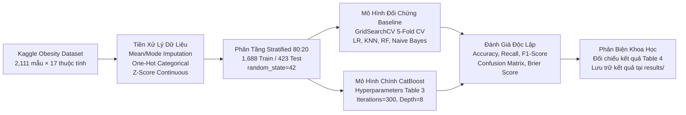
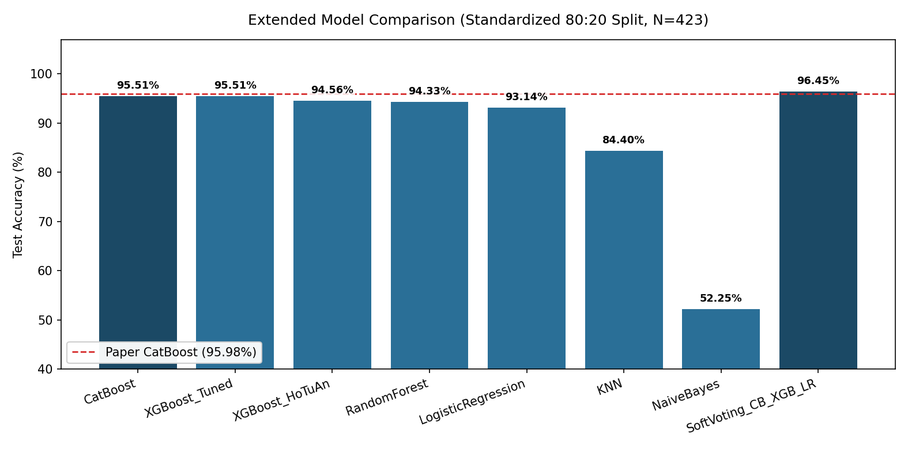
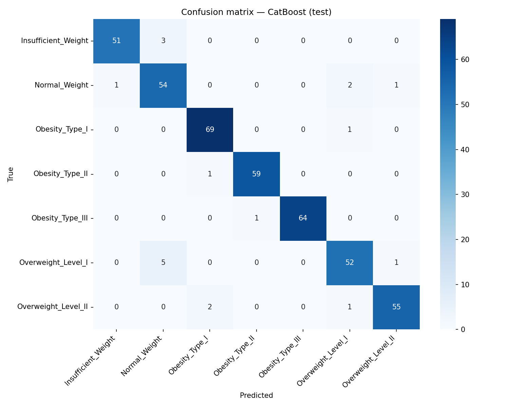
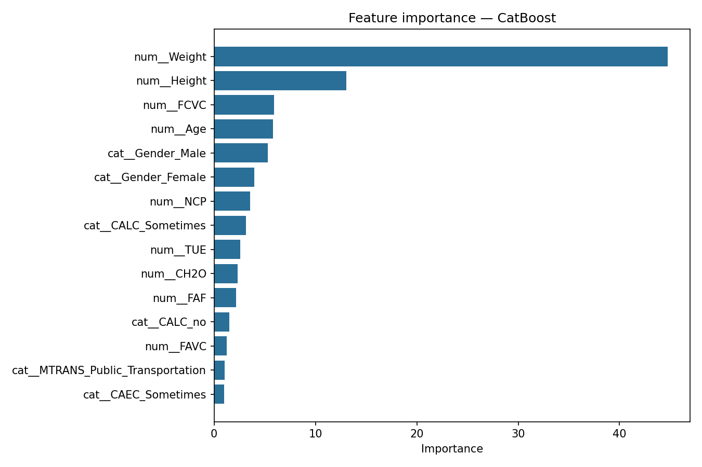
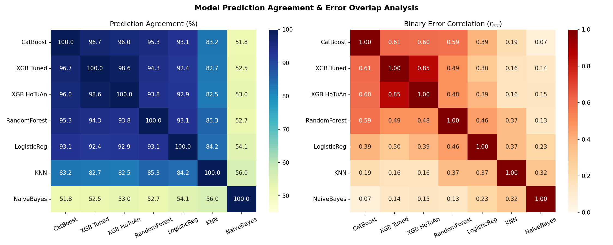
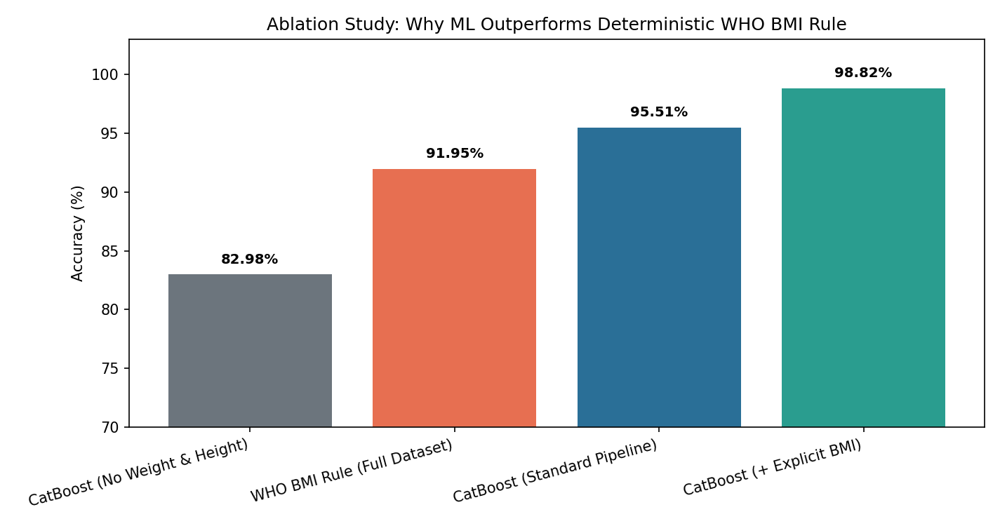

# Nghiên Cứu & Dự Đoán Mức Độ Béo Phì Bằng Học Máy (Estimation of Obesity Levels)

[](https://www.python.org/)
[](https://catboost.ai/)
[](https://www.kaggle.com/datasets/fatemehmehrparvar/obesity-levels)
[](LICENSE)
[](#)

> **Dự án Nghiên cứu Giữa kỳ — Môn học Trí tuệ Nhân tạo (Research Track)**  
> **Đơn vị:** Khoa Công nghệ Thông tin, Trường Đại học Công nghệ — Đại học Quốc gia Hà Nội (VNU-UET)  
> **Nhóm thực hiện:** Nhóm 10  
> **Nhiệm vụ trọng tâm:** Tái lập độc lập công trình khoa học quốc tế của **Maulana et al. (2024)**, so sánh chuyên sâu mô hình **CatBoost** với các mô hình baseline trên CPU cục bộ, đồng thời thực hiện phản biện học thuật và khảo sát mở rộng.

---

## 📌 Tóm Tắt Đề Tài & Mục Tiêu Nghiên Cứu

* **Bài toán y tế công cộng:** Béo phì là nguyên nhân hàng đầu gây ra các bệnh tim mạch và rối loạn chuyển hóa. Đề tài tập trung phân loại chính xác 7 mức độ thể trạng (`NObeyesdad`) dựa trên đặc điểm nhân trắc học và thói quen sinh hoạt (dinh dưỡng, vận động, tiêu thụ đồ uống, phương tiện di chuyển).
* **Mô hình trung tâm:** Tái lập thuật toán **CatBoost** với bộ siêu tham số chuẩn từ bài báo (*learning_rate=0.05, depth=8, l2_leaf_reg=5, iterations=300*).
* **Mô hình đối chứng (Baseline):** Random Forest, Logistic Regression, K-Nearest Neighbors (KNN), Naive Bayes (được tối ưu hóa qua Stratified 5-Fold Cross-Validation).
* **Kết quả chính:** Mô hình CatBoost của nhóm đạt độ chính xác **95.51%** (bám sát kết quả công bố **95.98%** của bài báo với độ lệch chỉ $-0.47\%$).
* **Đóng góp phản biện khoa học:** Chứng minh mâu thuẫn toán học (lỗi đánh máy Typo) ở mô hình Naive Bayes trong bài báo gốc và giải mã hiện tượng hội tụ tham số giúp Logistic Regression đạt **93.14%** (vượt trội so với 65.48% trong bài báo).

---

## 🔄 Sơ Đồ Quy Trình Thực Nghiệm (Pipeline Architecture)



---

## 📂 Cấu Trúc Repository

Cấu trúc dự án được chuẩn hóa theo phong cách nghiên cứu tái lập (Reproducible Research):

| Thư mục / Tệp | Vai trò & Nội dung chi tiết |
| :--- | :--- |
| [`src/`](src/) | Toàn bộ mã nguồn cốt lõi tái sử dụng: `preprocess.py`, `train.py`, `train_xgboost.py`, `analyze_models.py`, `select_features.py`, `evaluate.py`, `download_data.py` |
| [`data/`](data/) | Dữ liệu cục bộ (được `.gitignore` bảo vệ, tự động tải qua script; xem [`data/README.md`](data/README.md)) |
| [`notebooks/`](notebooks/) | Các sổ tay Jupyter chạy theo quy trình: `01_eda` $\rightarrow$ `02_baseline` $\rightarrow$ `03_main_model` |
| [`results/`](results/) | Bảng số liệu thực nghiệm (`.csv`, `.json`) và các biểu đồ phân tích trực quan ([`results/figures/`](results/figures/)) |
| [`reports/`](reports/) | Các báo cáo nghiên cứu markdown: [`san_pham_1_khao_sat.md`](reports/san_pham_1_khao_sat.md), [`san_pham_2_nghien_cuu.md`](reports/san_pham_2_nghien_cuu.md), [`ket_luan_sau_khi_thuc_nghiem_tu_bai_bao_nay.md`](reports/ket_luan_sau_khi_thuc_nghiem_tu_bai_bao_nay.md) |
| [`ai_log/`](ai_log/) | **Sản phẩm 3:** Nhật ký minh bạch hóa việc sử dụng AI theo quy định của môn học ([`ai_log/README.md`](ai_log/README.md)) |
| [`docs/`](docs/) | Tài liệu đề bài (`AI_Midterm_Project.pdf`) và các bài báo khoa học tham chiếu gốc (`.pdf`) |
| `CITATION.cff` | Tệp siêu dữ liệu trích dẫn chuẩn hóa của dự án |
| `LICENSE` | Giấy phép mã nguồn mở MIT |

---

## 🚀 Hướng Dẫn Cài Đặt & Chạy Thực Nghiệm (Quick Start)

Dự án được tối ưu hóa để chạy hoàn toàn trên **CPU thông thường**, không đòi hỏi phần cứng GPU chuyên dụng.

### 1. Khởi tạo môi trường ảo

**Trên Windows (PowerShell / CMD):**
```powershell
python -m venv .venv
.venv\Scripts\activate
pip install -r requirements.txt
```

**Trên Linux / macOS:**
```bash
python3 -m venv .venv
source .venv/bin/activate
pip install -r requirements.txt
```

### 2. Tải dữ liệu từ Kaggle
```bash
python -m src.download_data
```

### 3. Huấn luyện mô hình & Xuất kết quả
```bash
# Tiền xử lý dữ liệu và kiểm tra cấu trúc đặc trưng
python -m src.preprocess

# Huấn luyện bộ 5 mô hình theo bài báo Maulana et al. (2024)
python -m src.train

# Chạy đối chứng XGBoost (cấu hình của HoTuAn & GridSearchCV)
python -m src.train_xgboost

# Phân tích lỗi, độ tương quan mô hình & thí nghiệm phản biện BMI (Ablation Study)
python -m src.analyze_models
```

> [!IMPORTANT]
> Luôn thực thi các câu lệnh từ thư mục gốc của repository (`obesity-ml-research/`) để đảm bảo các đường dẫn tương đối trỏ chính xác vào `data/` và `results/`.

> [!TIP]
> Để chạy thử nghiệm dò lại lưới siêu tham số mở rộng của CatBoost, thêm cờ:
> ```bash
> python -m src.train --tune-catboost
> ```

---

## 📊 Kết Quả Thực Nghiệm Đối Chiếu (Local CPU vs. Paper Table 4)

Kết quả thực nghiệm độc lập trên cùng tập kiểm thử chuẩn hóa ($N=423$, tỷ lệ Stratified 80:20, `random_state=42`):

| Mô hình (Model) | Accuracy Paper (%) | Accuracy Local (%) | Độ lệch $\Delta$ (pp) | Recall Local (%) | F1-Score Local (%) | Số lỗi / 423 | Ghi chú & Đánh giá |
| :--- | :---: | :---: | :---: | :---: | :---: | :---: | :--- |
| **CatBoost (Chính)** | **95.98** | **95.51** | **−0.47** | **95.51** | **95.53** | **19** | **Tái lập sát bài báo, mô hình gốc dẫn đầu** |
| **XGBoost (Tuned)** *(Mở rộng)* | — | **95.51** | — | **95.51** | **95.55** | **19** | GridSearchCV (`lr=0.1, depth=4, n=200`) |
| **XGBoost (HoTuAn)** *(Mở rộng)* | — | 94.56 | — | 94.56 | 94.61 | 23 | Cấu hình mặc định (`lr=0.1, depth=6, n=100`) |
| **Random Forest** | 95.04 | 94.33 | −0.71 | 94.33 | 94.44 | 24 | Bám sát bài báo, họ cây xử lý dữ liệu bảng rất tốt |
| **Logistic Regression** | 65.48 | 93.14 | **+27.66** | 93.14 | 93.10 | 29 | Hội tụ khi `max_iter=2000` và scale chuẩn Z-score |
| **KNN** | 88.18 | 84.40 | −3.78 | 84.40 | 83.52 | 66 | Khoảng cách bị nhiễu bởi biến One-Hot |
| **Naive Bayes** | ⚠️ 94.07 | 52.25 | **−41.82** | 52.25 | 48.53 | 202 | Vi phạm giả định độc lập & lỗi Typo trong bài báo |
| **Soft Voting (CB + XGB + LR)** *(Thử nghiệm)* | — | **96.45** | — | **96.45** | **96.48** | **15** | Kết hợp mô hình cây + tuyến tính bù lỗi chéo |

---

## 📈 Trực Quan Hóa Kết Quả Thực Nghiệm

Toàn bộ biểu đồ được tự động sinh và lưu tại [`results/figures/`](results/figures/):

| So sánh độ chính xác mở rộng | Ma trận nhầm lẫn CatBoost (95.51%) | Mức độ quan trọng của đặc trưng |
| :---: | :---: | :---: |
|  |  |  |
| *CatBoost & XGBoost Tuned dẫn đầu nhóm mô hình đơn (95.51%); Soft Voting đạt 96.45%* | *Phân loại xuất sắc cả 7 lớp, cực kỳ nhạy với béo phì nặng* | *Weight và Height chi phối mạnh nhất, kế đến FCVC, Age, Gender* |

---

## 🔍 Phân Tích Lỗi, Tương Quan Mô Hình & Phản Biện Luật BMI

### 1. Các mô hình thường sai ở đâu? (Error Analysis)
* **Điểm nghẽn chung ở ranh giới BMI = 25.0 (`Overweight_Level_I` $\leftrightarrow$ `Normal_Weight`):** Khi chỉ có `Weight` và `Height` rời rạc mà chưa có biến phi tuyến $BMI = W / H^2$, cả 3 mô hình mạnh nhất đều dồn phần lớn lỗi vào cặp liền kề này: chiếm **36.8%** lỗi của CatBoost (7/19 ca), **50.0%** lỗi của Random Forest (12/24 ca), **51.7%** lỗi của Logistic Regression (15/29 ca), và **43.5%** lỗi của XGBoost HoTuAn (10/23 ca).
* **Lỗi đặc thù của KNN (66 lỗi):** F1 lớp `Normal_Weight` tụt xuống **55.32%** (bị nhầm sang `Insufficient_Weight` 12 ca, `Overweight_Level_I` 8 ca...) do các biến One-Hot thói quen sinh hoạt làm loãng khoảng cách Euclidean.
* **Nghịch lý Naive Bayes (202 lỗi):** F1 ở 6 lớp đầu rất thấp (23%–54%), nhưng riêng **`Obesity_Type_III` đạt F1 = 99.22%** do nhóm béo phì nặng có đặc trưng đồng nhất và tách biệt hẳn về mặt phân phối.

### 2. Mức độ tương quan & Khả năng bù lỗi giữa các mô hình
* **Độ đồng thuận (Prediction Agreement):** `CatBoost` và `XGBoost Tuned` đồng thuận tới **96.69%** (chỉ khác nhau trên 14/423 mẫu — mỗi bên thắng đúng 7 mẫu). `CatBoost` với `Random Forest` đồng thuận **95.27%**.
* **Tương quan lỗi ($r_{\text{err}}$):** `CatBoost` $\leftrightarrow$ `XGBoost Tuned` có $r_{\text{err}} = 0.61$, `CatBoost` $\leftrightarrow$ `RandomForest` là $0.59$ (cùng họ cây nên hay sai chung các mẫu sát biên BMI). Trong khi đó, `Logistic Regression` có tương quan lỗi thấp hơn rõ rệt với nhóm cây ($r_{\text{err}} = 0.30$ với XGBoost và $0.39$ với CatBoost). Nhờ tính bổ trợ này, **Soft Voting (CatBoost + XGBoost + LogisticRegression)** giảm số lỗi từ 19 xuống chỉ còn **15 ca (96.45%)**.

| Tương quan đồng thuận dự đoán (%) & Tương quan lỗi ($r_{\text{err}}$) | Thí nghiệm Phản biện BMI (Ablation Study) |
| :---: | :---: |
|  |  |

### 3. Tại sao có `Weight` & `Height` mà không dùng công thức BMI luôn? (Ablation Study)
Nhóm thực hiện kiểm chứng trực tiếp bằng thực nghiệm đối chứng (chi tiết tại [`results/bmi_ablation_results.csv`](results/bmi_ablation_results.csv)):

| Kịch bản thử nghiệm | Phạm vi đánh giá | Accuracy (%) | F1-Score (%) | Số mẫu sai | Ý nghĩa khoa học |
| :--- | :---: | :---: | :---: | :---: | :--- |
| **CatBoost (Bỏ `Weight` & `Height`)** | Test ($N=423$) | **82.98** | 82.96 | 72 | Chỉ dùng 14 biến thói quen/tuổi/giới tính vẫn dự báo rất tốt (random = 14.3%) |
| **Luật cứng BMI WHO ($W/H^2$)** | Full ($N=2111$) | **91.95** | 91.90 | 170 | **Thua CatBoost!** Do SMOTE nội suy tuyến tính làm phi tuyến ngưỡng BMI (sót 56 ca Type III có BMI < 40) |
| **CatBoost (Pipeline chuẩn)** | Test ($N=423$) | **95.51** | 95.53 | 19 | Tự động bù đắp độ lệch biên nhờ học kết hợp tín hiệu hành vi |
| **CatBoost (+ Cột `BMI` tường minh)** | Test ($N=423$) | **98.82** | 98.82 | 5 | Xác nhận khi cung cấp đặc trưng phi tuyến tường minh, hiệu năng đạt gần tuyệt đối |

---

## 🔬 Các Phát Hiện & Phản Biện Khoa Học Từ Bài Báo Gốc

1. **Phát hiện lỗi đánh máy (Typo) toán học ở Naive Bayes trong bài báo gốc:**
   * Trong bài báo gốc Table 4, mô hình Naive Bayes được ghi nhận có *Weighted Recall = 64.07%* nhưng *Accuracy = 94.07%*.
   * Về mặt toán học trong phân loại đa lớp có trọng số, công thức tính $\text{Weighted Recall}$ đồng nhất tuyệt đối với $\text{Accuracy}$. Do đó, việc Recall là 64.07% nhưng Accuracy lại là 94.07% là điều bất khả thi về mặt toán học. Nhóm chứng minh tác giả bài báo đã mắc lỗi đánh máy (gõ nhầm số `6` thành `9`), và độ chính xác thực tế chỉ đạt ~52%–64%.
2. **Giải mã nghịch lý Logistic Regression (93.14% vs. 65.48%):**
   * Lớp `LogisticRegression` của Scikit-learn có giá trị mặc định `max_iter=100`, không đủ để thuật toán tối ưu L-BFGS hội tụ trên dữ liệu 27 chiều của bài toán này.
   * Khi nhóm áp dụng đúng chuẩn hóa Z-score và thiết lập `max_iter=2000`, Logistic Regression hội tụ hoàn toàn và đạt độ chính xác ấn tượng 93.14%.

> Chi tiết các luận cứ toán học và phân tích chuyên sâu được trình bày tại: [`reports/ket_luan_sau_khi_thuc_nghiem_tu_bai_bao_nay.md`](reports/ket_luan_sau_khi_thuc_nghiem_tu_bai_bao_nay.md).

---

## 🧩 Khảo Sát & Nghiên Cứu Mở Rộng

<details>
<summary><b>1. Nghiên cứu Mạng Nơ-ron Nhân tạo (ANN) tối ưu hóa Bayes — Click để xem</b></summary>

Nhóm tiến hành khảo sát mở rộng mô hình Deep Learning theo công trình của **Yagin et al. (2023)** (*Applied Sciences*):
* **Kiến trúc mạng:** 3 tầng gồm `Dense(ReLU)` $\rightarrow$ `BatchNormalization` $\rightarrow$ `Softmax(7 lớp)`.
* **Tối ưu siêu tham số Bayesian:** Sử dụng thuật toán Gaussian Process (`skopt.gp_minimize`) tối ưu đồng thời số neuron ẩn (`units`), tốc độ học (`lr`), số `epoch` và `batch_size`.
* **Tuyển chọn 5 đặc trưng:** Chạy `python -m src.select_features --mode paper` để sinh `data/splits/top5_features.json` cùng các tập CSV đã lọc (`chi2`, `f_classify`, `mutual_info`).
* Mã nguồn cốt lõi trên nhánh `main`: [`src/select_features.py`](src/select_features.py), [`src/lr_baseline.py`](src/lr_baseline.py), [`src/ann_model.py`](src/ann_model.py), [`src/benchmark_ann.py`](src/benchmark_ann.py), [`src/check_ann.py`](src/check_ann.py) (phần script `bayes_search.py` & `metrics_ann.py` lưu trên nhánh nghiên cứu `model-optimization-lead`).
</details>

<details>
<summary><b>2. Thử nghiệm đối chứng XGBoost (HoTuAn) — Click để xem</b></summary>

* Đã chuẩn hóa script của HoTuAn từ nhánh `xgboost` vào [`src/train_xgboost.py`](src/train_xgboost.py) sử dụng chung pipeline [`src/preprocess.py`](src/preprocess.py) và [`src/evaluate.py`](src/evaluate.py).
* Kết quả lưu tại [`results/xgboost_results.csv`](results/xgboost_results.csv) và [`results/figures/confusion_matrix_xgboost.png`](results/figures/confusion_matrix_xgboost.png) (`XGBoost_HoTuAn`: **94.56%**, `XGBoost_Tuned`: **95.51%**).
</details>

---

## 👥 Nhóm Tác Giả & Phân Công (Authors & Affiliations)

**Nhóm 10 — Môn học Trí tuệ Nhân tạo (Research Track)**  
*Khoa Công nghệ Thông tin, Trường Đại học Công nghệ — Đại học Quốc gia Hà Nội (VNU-UET)*

* **Thành viên nhóm:** Nhóm 10 ([`@hai-dep-try`](https://github.com/hai-dep-try), [`@HoTuAn2007`](https://github.com/HoTuAn2007), [`@chử minh`](https://github.com/chuducminnh))
* **Phân công nghiên cứu:**
  * Xây dựng pipeline tiền xử lý, tái lập CatBoost & các mô hình baseline, phản biện học thuật bài báo Maulana et al. (2024).
  * Khảo sát mô hình Deep Learning ANN & quy trình tối ưu Bayes theo Yagin et al. (2023).
  * Thử nghiệm mô hình XGBoost đối chứng & tổng hợp hệ thống báo cáo Word/Markdown.

---

## 📖 Tài Liệu Tham Chiếu (References)

1. **Maulana, A., Afidh, R. P. F., Maulydia, N. B., Idroes, G. M., & Rahimah, S. (2024).** *Predicting Obesity Levels with High Accuracy: Insights from a CatBoost Machine Learning Model*. Infolitika Journal of Data Science, 2(1), 17–27. [DOI: 10.60084/ijds.v2i1.195](https://doi.org/10.60084/ijds.v2i1.195).
2. **Yagin, F. H., Gülü, M., Gormez, Y., Castañeda-Babarro, A., Colak, C., Greco, G., Fischetti, F., & Cataldi, S. (2023).** *Estimation of Obesity Levels with a Trained Neural Network Approach optimized by the Bayesian Technique*. Applied Sciences, 13(6), 3875. [DOI: 10.3390/app13063875](https://doi.org/10.3390/app13063875).
3. **Palechor, F. M., & de la Hoz Manotas, A. (2019).** *Dataset for estimation of obesity levels based on eating habits and physical condition in individuals from Colombia, Peru and Mexico*. Data in Brief, 25, 104344. [DOI: 10.1016/j.dib.2019.104344](https://doi.org/10.1016/j.dib.2019.104344).

---

## 🤖 Tuyên Bố Minh Bạch Sử Dụng AI (Statement of AI Use)

Theo đúng quy định tại Mục II đề tài nghiên cứu giữa kỳ môn Trí tuệ Nhân tạo:
* Toàn bộ mã nguồn, thiết kế thực nghiệm, quá trình phân tích số liệu và các phát hiện phản biện khoa học trong dự án này do các thành viên trong nhóm trực tiếp xây dựng, kiểm chứng và chịu trách nhiệm học thuật.
* Các công cụ AI (như Claude, ChatGPT) chỉ được sử dụng với vai trò trợ lý hỗ trợ tra cứu cú pháp thư viện, gợi ý định dạng Markdown/LaTeX và rà soát lỗi chính tả.
* Mọi tương tác chuyên môn với công cụ AI đều được nhóm ghi chép đầy đủ, minh bạch tại thư mục [`ai_log/`](ai_log/) (Sản phẩm 3).
